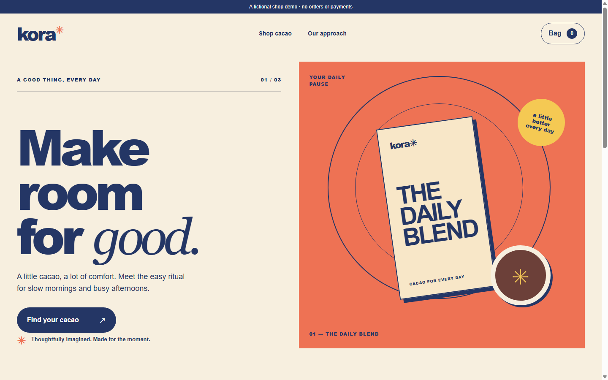
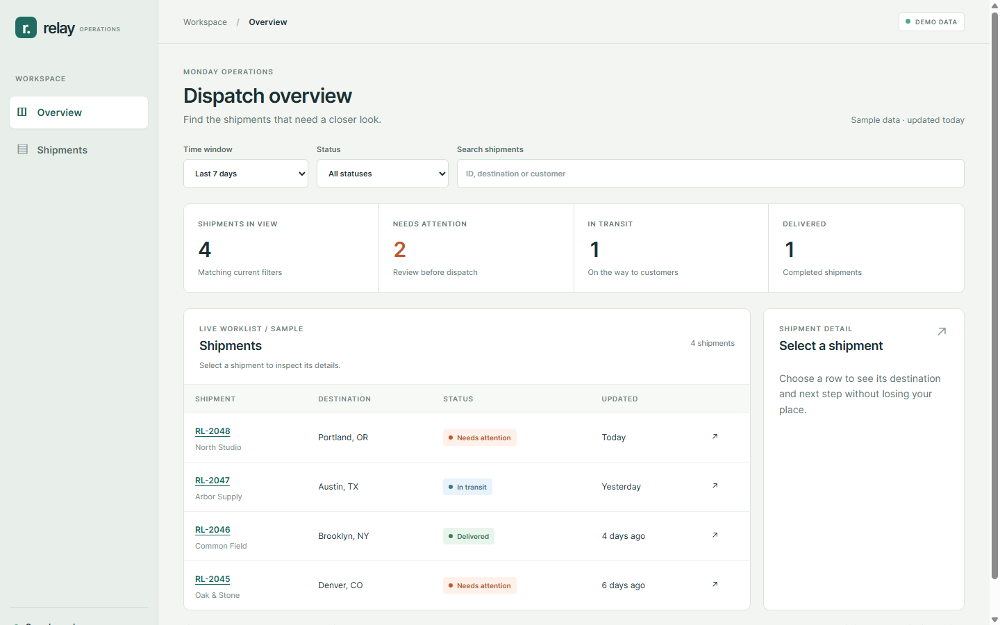
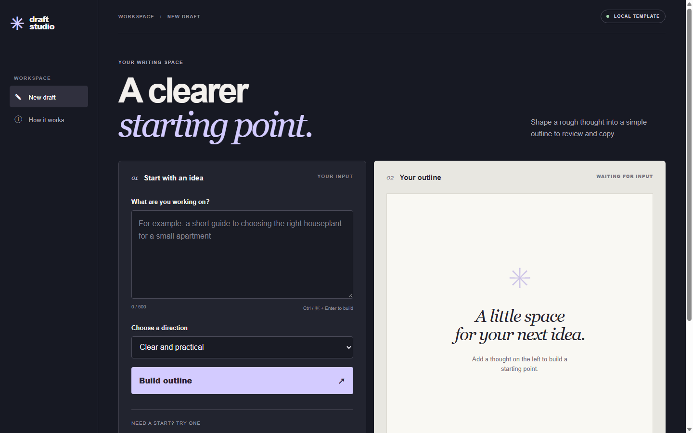
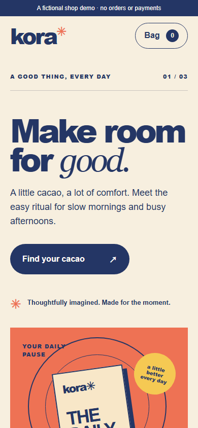
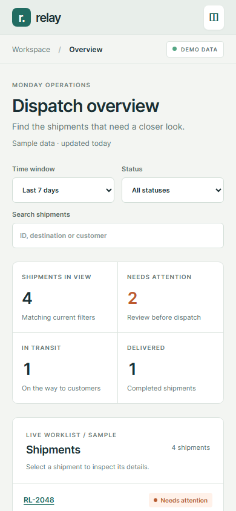
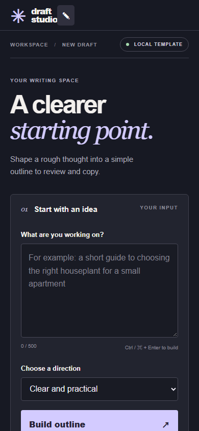

<p align="center"><a href="README.md">中文</a> · <strong>English</strong></p>

<h1 align="center">UI Design</h1>

<p align="center">Design and build interfaces around their users, content, and tasks.</p>

<p align="center">
  <a href="https://github.com/huang12chen/portfolio-ui-design/actions/workflows/ci.yml"></a>
  <a href="LICENSE"></a>
</p>

<p align="center"><a href="#install">Install</a> · <a href="#examples">Examples</a> · <a href="#run-the-examples">Run examples</a> · <a href="#checks-and-review">Checks</a> · <a href="docs/faq.md">FAQ</a></p>

A UI design Skill for coding tools such as Codex, Claude Code, and Cursor. It helps an agent research references, choose a visual direction, build interactions, and inspect the result on desktop and mobile. Use it for brand sites, shops, dashboards, AI products, portfolios, and other interfaces. A category does not dictate one visual style.

## Install

Run this in your project and select your coding tool:

```sh
npx skills add huang12chen/portfolio-ui-design --skill portfolio-website
```

Requires Node.js 22.20+. This installs to the current project; add `-g` for your user directory. See [manual installation, discovery, and updates](docs/install.md).

The invocation name remains `portfolio-website` for existing installations. Use `$portfolio-website` in Codex or `/portfolio-website` in Claude Code.

## How to use it

Describe the audience, main task, existing identity or material, technical constraints, and anything that should remain private. For example:

> Use $portfolio-website to build a shop for an independent coffee brand. Customers should be able to compare products, select an option, and review their bag. Research suitable examples, develop a direction for this brand, and test the main interactions on desktop and mobile. Clearly label any checkout that is not connected.

You can also provide a résumé and work for a portfolio, or data and workflows for a dashboard. For an existing interface, describe the specific problem. [More example requests](docs/examples.md)

## Examples

These fictional examples demonstrate different information structures and visual directions. They are not templates every project should follow.

| Brand and shop | Operations dashboard | AI product interface |
| --- | --- | --- |
|  |  |  |
| Browse products and change a local bag; no checkout or payment. | Filter, search, linked metrics, and detail using sample data. | Suggested inputs and an outline built from a local template; no AI model is called. |

The bilingual [fictional portfolio](examples/alex-lin/dist/index.html) includes cases, a sample dashboard, and a content brief. Its person, employment history, and business figures are invented.

<details>
<summary>Mobile views</summary>





</details>

## Run the examples

Download or clone the repository, then run:

```sh
npm run dev:examples
```

Open the local address printed in the terminal and choose an example. Node.js 22+ is required; no npm dependencies, account, or API key are needed. The existing `npm run dev` command still serves the portfolio on its own. Press Ctrl+C to stop the server.

## Checks and review

For a compatible static build, run this from the installed Skill directory:

```sh
node scripts/selfcheck.mjs <built-site-dir>
```

Exit `0` means the requested checks found no issue, `1` means a measurable defect was found, and `2` means the requested checks could not finish. `--static-only` explicitly skips the browser. Some rules were developed for portfolios and may not fit every product; report unmeasured checks and judge false positives. An automated pass does not replace seeing the page and exercising its main flows.

Repository checks:

```sh
npm test
npm run check
npm run release
```

[Installation](docs/install.md) · [Example requests](docs/examples.md) · [Local release packages](docs/packages.md) · [Deploy the portfolio example](docs/deploy.md) · [Privacy](docs/privacy.md)

Original code, Skill, and documentation are [MIT licensed](LICENSE). See [third-party notices](THIRD_PARTY_NOTICES.md) for asset and license details.
