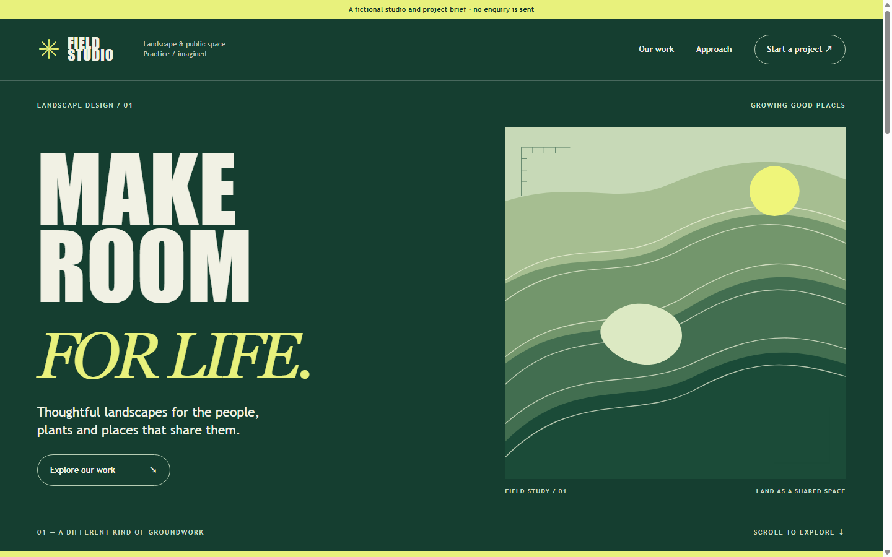
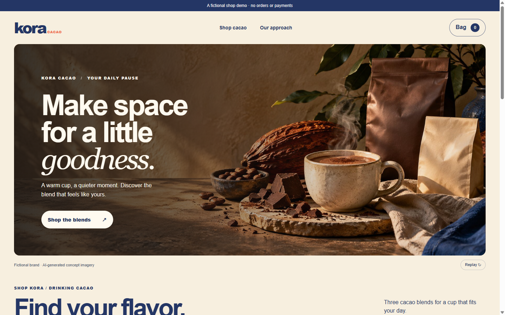
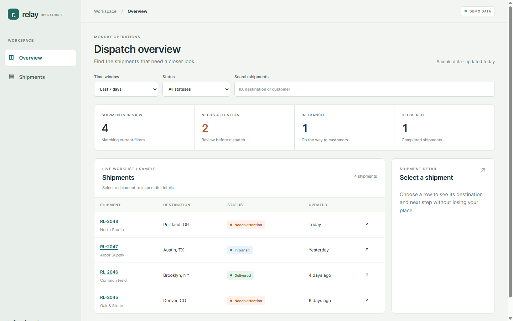
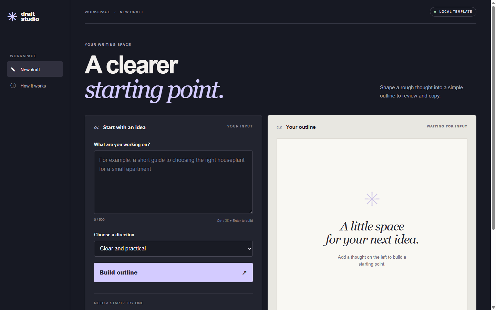
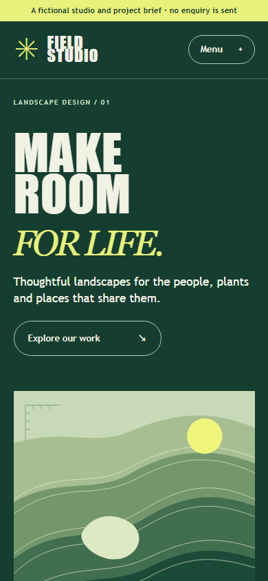
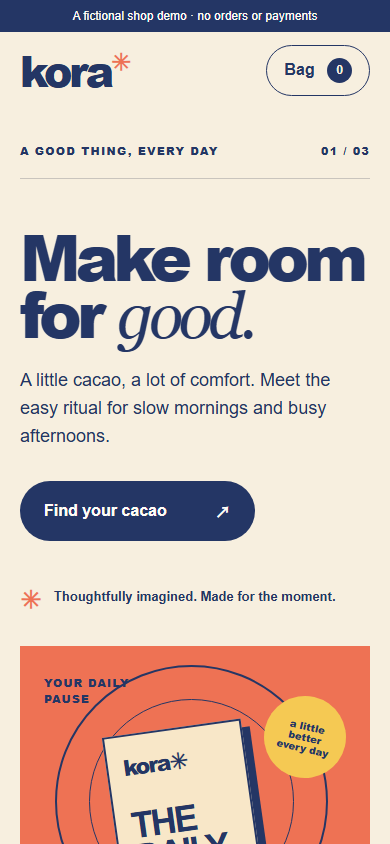
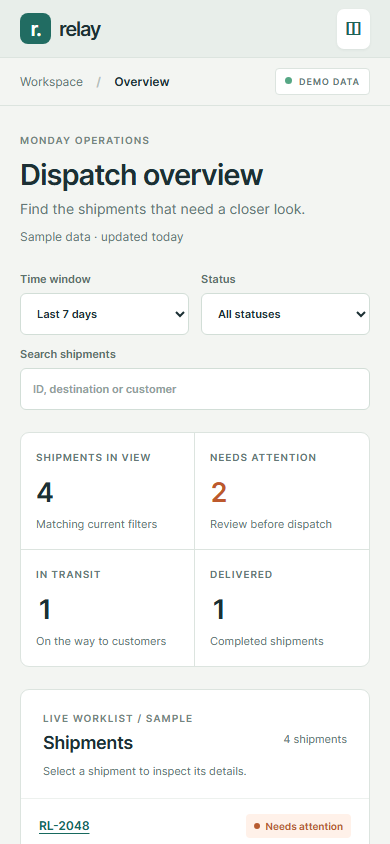
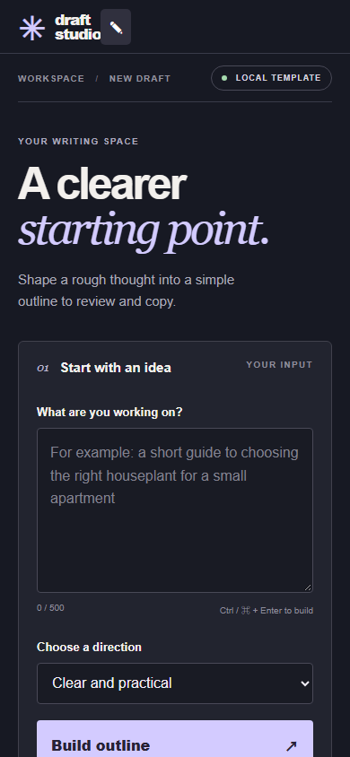

<p align="center"><strong>中文</strong> · <a href="README.en.md">English</a></p>

<h1 align="center">通用 UI 设计</h1>

<p align="center">根据不同用户、内容和任务，设计并实现适合的网站界面。</p>

<p align="center">
  <a href="https://github.com/huang12chen/portfolio-ui-design/actions/workflows/ci.yml"></a>
  <a href="LICENSE"></a>
</p>

<p align="center"><a href="#安装">安装</a> · <a href="#网站示例">网站示例</a> · <a href="#运行示例">运行示例</a> · <a href="#自检与验证">自检与验证</a> · <a href="docs/faq.md">常见问题</a></p>

这是给 Codex、Claude Code、Cursor 等编码工具使用的 UI 设计 Skill。它帮助你从目标用户、真实内容和主要任务出发，研究参考、选择视觉方向、实现交互，并检查桌面与手机上的实际页面。适用于品牌官网、商城、后台、AI 产品和作品集；同一行业也不必使用相同风格。

## 安装

在项目目录运行，按提示选择编码工具：

```sh
npx skills add huang12chen/portfolio-ui-design --skill portfolio-website
```

需要 Node.js 22.20+。默认安装到当前项目；添加 `-g` 可安装到用户目录。[手动安装、确认和更新](docs/install.md)

Skill 的调用名继续使用 `portfolio-website`，兼容以前的安装。Codex 中输入 `$portfolio-website`，Claude Code 中输入 `/portfolio-website`。

## 怎么使用

描述目标用户、要完成的任务、现有品牌或素材、技术限制和希望保密的内容。例如：

> 使用 $portfolio-website 为一家独立咖啡品牌制作商城。顾客需要比较商品、选择规格并查看购物袋。请先研究合适的案例，提出适合这个品牌的视觉方向，完成桌面和手机页面，并实际检查主要交互。没有接入支付的部分要明确标注。

也可以提供简历和作品，制作作品集；或提供数据和工作流程，设计后台。已有界面可以直接说明需要改进的地方。[更多使用示例](docs/examples.md)

## 网站示例

这些示例展示不同的信息结构与视觉方向，不是套用到所有项目的模板。品牌、人物和数据均为虚构。

| 服务品牌官网 | 品牌商城 |
| --- | --- |
|  |  |
| 服务介绍、工作方式与项目需求预览；不会发送咨询。 | 商品浏览、购物袋和数量调整；没有结账或支付。 |

| 运营后台 | AI 产品界面 |
| --- | --- |
|  |  |
| 筛选、搜索、指标联动与详情；使用示例数据。 | 建议输入与提纲生成；使用本地模板，没有调用 AI 模型。 |

另有中英文[虚构作品集](examples/alex-lin/dist/index.html)，包含案例、示例看板和内容简报。示例人物、任职经历和业务数字均为虚构。

<details>
<summary>查看手机界面</summary>






</details>

## 运行示例

下载或克隆仓库，在根目录运行：

```sh
npm run dev:examples
```

打开终端打印的本地地址，选择五个示例之一。需要 Node.js 22+，不需要 npm 依赖、账号或 API Key。原有作品集单独预览命令 `npm run dev` 仍然可用；按 Ctrl+C 停止服务。

## 自检与验证

对于兼容的静态构建产物，可以从安装后的 Skill 目录运行：

```sh
node scripts/selfcheck.mjs <构建产物目录>
```

退出码 `0` 表示所测规则没有发现，`1` 表示有规则发现，`2` 表示请求的检查未能完成。`--static-only` 会明确跳过浏览器。自检器包含从作品集场景形成的部分假设，可能不适合所有产品；需要逐条判断适用性，修复确认的问题，并报告未测项和误报。自动检查不能替代查看页面和操作主要流程。

仓库开发检查：

```sh
npm test
npm run check
npm run release
```

[安装指南](docs/install.md) · [使用示例](docs/examples.md) · [本地发布包](docs/packages.zh-CN.md) · [部署作品集示例](docs/deploy.zh-CN.md) · [隐私说明](docs/privacy.md)

原创代码、Skill 和文档使用 [MIT 许可](LICENSE)。示例中的素材与第三方许可说明见 [THIRD_PARTY_NOTICES.md](THIRD_PARTY_NOTICES.md)。
